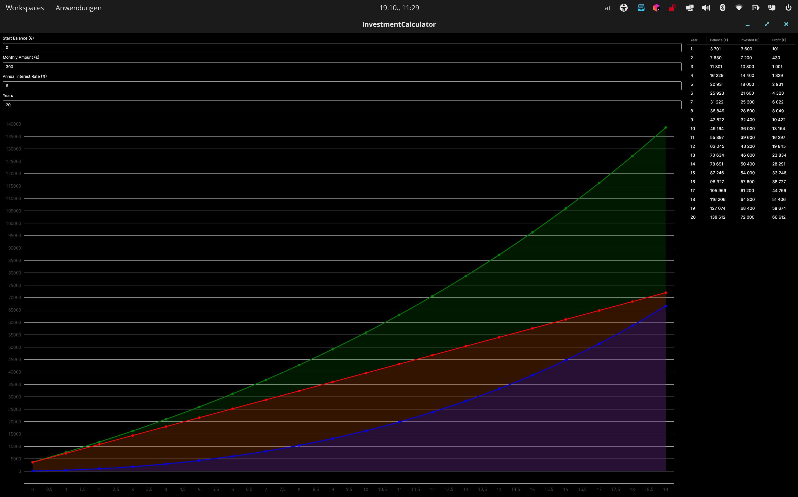

# Investment Calculator

A cross-platform desktop app that visualises how regular investments grow over time through compound interest. Enter a start balance, a monthly savings amount, an annual interest rate and a time horizon, and the chart and table update instantly as you type.

Built with **C# / .NET 9**, **Avalonia UI** and the **MVVM** pattern.

<!-- Add a screenshot here:  -->

## Features

- **Live recalculation**: every input is data-bound to the view model, so results update as you type, with no "Calculate" button
- **Interactive chart** (LiveCharts2 / SkiaSharp) showing three series over the years:
  - **Balance**: total portfolio value
  - **Invested**: start balance plus all contributions
  - **Profit**: balance minus invested capital (the compound-interest effect)
- **Year-by-year table** (Avalonia DataGrid) with balance, invested capital and profit
- **Cross-platform**: runs on Windows, Linux and macOS with the Fluent theme, and follows the system's light/dark mode

## How it calculates

Contributions are compounded **monthly**:

```
monthlyRate = annualRate / 100 / 12

each month:  balance = balance + balance × monthlyRate + monthlyAmount
invested(year) = startBalance + year × 12 × monthlyAmount
profit = balance − invested
```

Interest is credited before the month's contribution is added. Taxes, fees and inflation are not modelled.

## Architecture

```
InvestmentCalculator/
├── Program.cs                         # App entry point / AppBuilder (ReactiveUI enabled)
├── App.axaml(.cs)                     # Application, Fluent theme, DataGrid styles
├── ViewLocator.cs                     # Resolves views from view models by naming convention
├── Models/
│   └── YearlyResult.cs                # Year, Balance, Invested, computed Profit
├── ViewModels/
│   ├── ViewModelBase.cs               # ReactiveObject base class
│   └── MainWindowViewModel.cs         # Inputs, calculation, chart series, ObservableCollection
└── Views/
    └── MainWindow.axaml(.cs)          # Input form, CartesianChart, DataGrid (compiled bindings)
```

- **MVVM**: the view contains no logic. It binds to `MainWindowViewModel` through compiled bindings (`x:DataType`).
- **Reactive updates**: input properties use ReactiveUI's `RaiseAndSetIfChanged`, and any change triggers a recalculation of the `ObservableCollection<YearlyResult>` and the chart series.

## Tech stack

| Area | Technology |
|------|------------|
| Language / runtime | C#, .NET 9 |
| UI framework | Avalonia UI 11.2 (Fluent theme, DataGrid) |
| MVVM | ReactiveUI, CommunityToolkit.Mvvm |
| Charts | LiveChartsCore 2 (SkiaSharp) |

## Getting started

Requires the [.NET 9 SDK](https://dotnet.microsoft.com/download).

```bash
git clone https://github.com/raphi-web/investment_calculator.git
cd investment_calculator
dotnet run
```

Build a self-contained release, for example for Linux:

```bash
dotnet publish -c Release -r linux-x64 --self-contained
```

Use `win-x64` or `osx-arm64` as the runtime identifier for other platforms.
